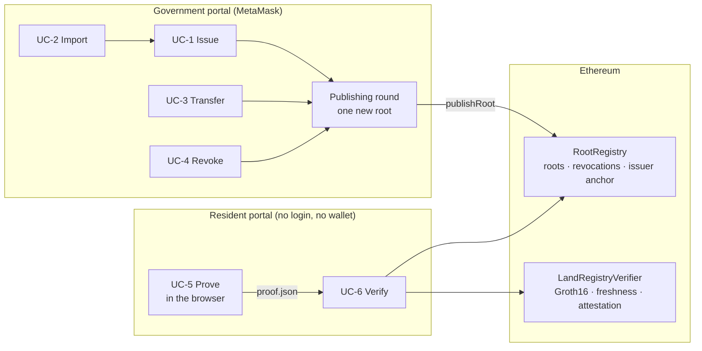

# Land Registry ZKP

**A privacy-preserving Land Use Rights (LUR) registry for Vietnam — sparse Merkle tree commitments and Groth16 zero-knowledge proofs on Ethereum.**

[](LICENSE)


> Thesis project by **Bui Cong Vinh** (ITCSIU22165) — International University, Vietnam National University Ho Chi Minh City.
> If you use or build on this work, please cite it: see [`CITATION.cff`](CITATION.cff) or GitHub's _Cite this repository_ button.

Land records stay off-chain with the land offices; only the **Merkle root** of the registry is anchored on Ethereum. An owner can then prove a statement about their plot — _"I hold this title"_, _"this title is unencumbered and has at least N years left"_ — without revealing the record or their identity, and anyone can check that proof against the chain without trusting the registry's server.

The legal model follows the 2024 Land Law, Decree 151/2025/ND-CP and Circular 08/2024/TT-BTNMT.

---

## How it works



| Use case          | Who                           | What happens                                                                                                                                                                               |
| ----------------- | ----------------------------- | ------------------------------------------------------------------------------------------------------------------------------------------------------------------------------------------ |
| **UC-1 Issue**    | Central land office           | Queues imported plots for a first certificate. The owner's secret is generated here; the bundle (`receipt.json`, `secret.json`, certificate PDF) is delivered once the round is published. |
| **UC-2 Import**   | Central land office           | Bulk CSV import with a dry run, validated against the 2024 Land Law (land-use codes, tenure per Article 171) and the post-2025 commune catalog.                                            |
| **UC-3 Transfer** | Branch office, at the counter | Checks the seller's bundle, issues the buyer's secret and verifies a `transfer` proof before approving.                                                                                    |
| **UC-4 Revoke**   | Branch office                 | Queues a revocation with a reason code. The free-text reason stays off-chain; only its hash is published.                                                                                  |
| **UC-5 Prove**    | Owner                         | Loads their bundle and generates an ownership or clean-title proof in a Web Worker. The secret never leaves the browser.                                                                   |
| **UC-6 Verify**   | Bank, buyer, notary           | Checks freshness, the Groth16 proof, the on-chain root, the issuer's X.509 chain, revocation status and the status attestation — without asking the backend whether the proof is valid.    |

Issuances, approved transfers and revocations are published together in one **round**: the central office signs a single `publishRoot` (or `publishRootWithRevocations`) in MetaMask, and the database is only updated once that root is on-chain. Every other change — re-issue, split, merge — is modelled as a revocation plus a new issuance with a new `propertyId`.

## Design highlights

- **One leaf per plot.** A leaf's index in the depth-24 sparse Merkle tree _is_ its `propertyId` (up to 16,777,215 plots), and the circuits constrain it. After a transfer or revocation the old leaf has no path to the new root, so the old owner can no longer prove anything.
- **Seven-field Poseidon leaf.** `Poseidon(propertyId, ownerCommitment, useType, validityPeriod, encumbranceStatus, tenureType, offchainHash)`, where `offchainHash` commits to the printed certificate fields (address, area, …) that never go on-chain.
- **Freshness.** `currentTimestamp` is a public input the prover chooses, so the contract and the off-chain verifier both require it to be within 600 s of now — a back-dated proof for an expired title is rejected.
- **Status attestation.** Ownership and clean-title proofs carry a short-lived EIP-712 signature stating the plot has no open transfer or revocation, which closes the window between the counter and the next round.
- **Issuer identity.** A demo Government Root CA issues the land office's X.509 certificate; its organization name is hashed on-chain by `registerAuthority`, and the verifier checks the whole chain in the browser.
- **Revocations on-chain.** One bit per `propertyId` (`isRevoked(id)`); the reason code and detail hash are emitted as events for public audit.
- **Built for Ho Chi Minh City scale.** The tree lives in PostgreSQL (`merkle_nodes`): a Merkle path is 24 primary-key lookups, and a round rewrites only the paths it touches.
- **One copy of the crypto.** Poseidon, the tree and the leaf layout live only in `blockchain/shared/`, imported by both the backend and the browser.

### Circuits

| Circuit     | Proves                                                  | Constraints | Public signals                                                                                                                             |
| ----------- | ------------------------------------------------------- | ----------- | ------------------------------------------------------------------------------------------------------------------------------------------ |
| `ownership` | the prover holds the title and its term has not expired | 14,270      | `merkleRoot`, `propertyId`, `ownerCommitment`, `currentTimestamp`                                                                          |
| `mortgage`  | the title is unencumbered and has at least N years left | 14,270      | the four above + `minRequiredRemainingTerm`                                                                                                |
| `transfer`  | the same slot moves from the old owner to the new one   | 28,271      | `oldMerkleRoot`, `newMerkleRoot`, `propertyId`, `oldOwnerCommitment`, `newOwnerCommitment`, `currentTimestamp`, `minRequiredRemainingTerm` |

## Repository layout

```
blockchain/           circom circuits, Solidity contracts, Hardhat scripts, shared Merkle/ZKP code
├── circuits/         ownership, mortgage, transfer + common templates
├── contracts/        RootRegistry, LandRegistryVerifier (Groth16 verifiers are generated)
├── shared/           Poseidon, sparse Merkle tree, leaf layout, receipt format
└── deployments/      sepolia.json — the live testnet deployment
web-app/
├── backend/          NestJS API, Prisma + PostgreSQL, certificate bundles (PDF/ZIP), X.509 issuer
└── frontend/         Next.js 16: government portal (wagmi/RainbowKit) and resident portal
```

## Getting started

**Prerequisites:** Node.js ≥ 20, pnpm, Docker (PostgreSQL 16 on port 5433), Rust with `cargo install circom` (circom ≥ 2.2.3), and MetaMask for the government portal.

### 1. Install and configure

```bash
git clone https://github.com/SnowAceAlex/land-registry-zkp.git
cd land-registry-zkp
pnpm install
cp .env.example .env                   # read by Hardhat and Prisma
cp .env.example web-app/backend/.env   # read by the backend
echo "NEXT_PUBLIC_WALLETCONNECT_PROJECT_ID=<your id>" > web-app/frontend/.env
```

The defaults in `.env.example` are enough for a local chain. `GOV_API_KEY` is the head-office key you type into the government portal.

### 2. Database, certificates, circuits, contracts

```bash
pnpm run db:up                                   # PostgreSQL 16 on port 5433
pnpm --filter backend run db:migrate
pnpm --filter backend run cert:generate          # demo Root CA (pki/) + issuer certificate (certs/)
pnpm --filter blockchain run circuits:compile
pnpm --filter blockchain run circuits:setup      # Groth16 setup; downloads Powers of Tau on first run
pnpm run compile                                 # Solidity + TypeChain
```

### 3. Run

```bash
pnpm --filter blockchain run node                # terminal 1: local chain on :8545 (chain id 31337)
pnpm --filter blockchain run deploy:localhost    # terminal 2
pnpm run dev:backend                             # terminal 2: API on :3001 (Swagger at /api/docs)
pnpm run dev:frontend                            # terminal 3: app on :3000
```

Open <http://localhost:3000> and pick **Government** (enter `GOV_API_KEY`, connect MetaMask to `localhost:8545`) or **Resident** (no login).

Optional: `pnpm --filter backend run seed:admin-units <file>` loads the commune catalog, then `seed:land-offices` creates the branch offices CN01…CN38 and prints each office's key once.

Deploying to Sepolia is covered in [`DEPLOYMENT.md`](DEPLOYMENT.md) (Vietnamese).

### Tests

```bash
pnpm run test:blockchain           # Merkle layer, circuits, contracts
pnpm run test:backend              # Jest
pnpm --filter frontend run test    # Vitest
```

Tests that need real proofs skip themselves until `circuits:setup` has run.

## Sepolia deployment

Chain id `11155111`, deployed 2026-10-26. The full record is [`blockchain/deployments/sepolia.json`](blockchain/deployments/sepolia.json).

| Contract                   | Address                                                                                                                         |
| -------------------------- | ------------------------------------------------------------------------------------------------------------------------------- |
| `RootRegistry`             | [`0x173637ec906aF093C92e86C0E11d95849Fa77eb5`](https://sepolia.etherscan.io/address/0x173637ec906aF093C92e86C0E11d95849Fa77eb5) |
| `LandRegistryVerifier`     | [`0x661094990C4f1B8c14E8386BEAcC08953d01070d`](https://sepolia.etherscan.io/address/0x661094990C4f1B8c14E8386BEAcC08953d01070d) |
| `Groth16VerifierOwnership` | [`0xA0FcdACC0F0c56Ba564DEB13C2979316D615ed7A`](https://sepolia.etherscan.io/address/0xA0FcdACC0F0c56Ba564DEB13C2979316D615ed7A) |
| `Groth16VerifierMortgage`  | [`0xd48938358BbdbD1fD91b65Fdd5f4034b9bBc9261`](https://sepolia.etherscan.io/address/0xd48938358BbdbD1fD91b65Fdd5f4034b9bBc9261) |
| `Groth16VerifierTransfer`  | [`0xef7502fd73cE4B2a81BDDeE927e849B9a824fc3a`](https://sepolia.etherscan.io/address/0xef7502fd73cE4B2a81BDDeE927e849B9a824fc3a) |

State authority `0xc128Eb26F177BB6a3b4374A715be350887ED7726` (_So Tai nguyen va Moi truong TP.HCM_), status attester `0x55636981fA9f7b2c357025691C9a26B066dD25c8`.

## Tech stack

Circom 2.2.3 and snarkjs (Groth16 over BN254) · Solidity 0.8.36, OpenZeppelin 5, Hardhat 2 · NestJS 10, Prisma 7, PostgreSQL 16 · Next.js 16, React 19, wagmi 2, viem, RainbowKit · pdf-lib, @peculiar/x509.

## Status

Research prototype. The Root CA, land offices and keys are demo values, and the Groth16 phase-2 setup is a single local contribution rather than a multi-party ceremony, so it is not fit for production use.

## License

Copyright © 2026 Bui Cong Vinh.

Licensed under the [GNU Affero General Public License v3.0 only](LICENSE). You may use, study and modify this code, but any version you distribute or run as a network service must keep this notice and publish its complete source under the same license. Files that carry their own SPDX header are under that license.

This project builds on circomlib, circomlibjs and snarkjs (GPL-3.0); the generated Groth16 verifier contracts carry snarkjs's GPL-3.0 header.

This repository accompanies a thesis. Reusing it in academic work without citing it is plagiarism, whatever the code license allows.
